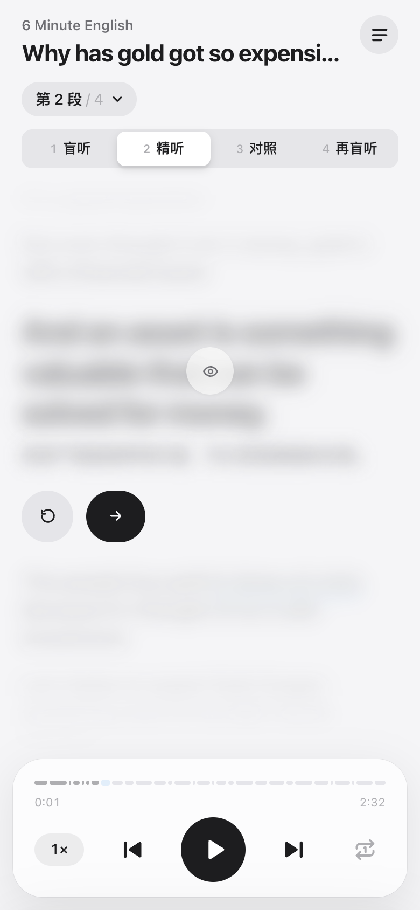
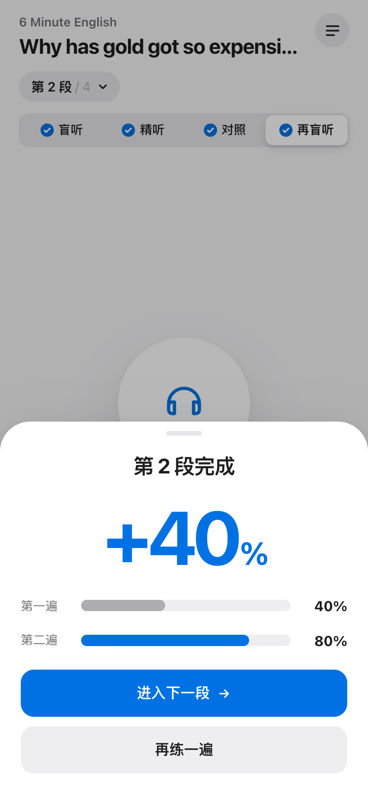
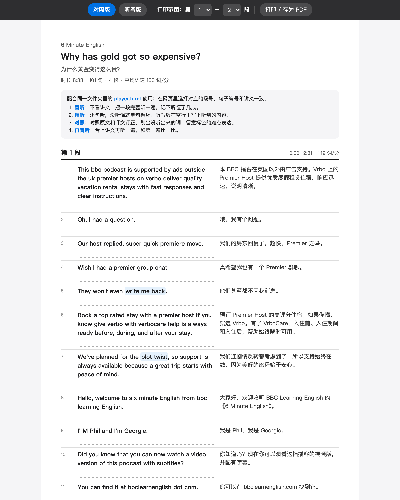

<div align="center">

# cherina-pod

**Turn any podcast episode into a listening-practice lesson — with one command.**

Line-by-line listening page · printable bilingual handout · key-phrase notes — all generated on your own machine

[](LICENSE)
[](https://www.python.org/)
[](SKILL.md)
[](https://github.com/realchendahuang/cherina-pod/actions/workflows/ci.yml)
[](https://github.com/realchendahuang/cherina-pod/stargazers)

[中文](README.md) · English


</div>

## What it does

Give it a podcast episode. It downloads the audio, transcribes it with **word-level timestamps**, translates every sentence, picks the 20 phrases most worth learning, and builds:

- **`player.html`** — an offline listening page with a guided four-step method (blind listen → line-by-line drill → compare with translation → blind listen again), word-by-word highlighting, sentence loop, speed control, and a before/after self-rating that shows your progress.
- **`handout.html`** — a printable side-by-side handout with a dictation mode and an answer key. Print to PDF from the browser.
- **`notes.md`** — key phrases with meaning, original sentence and timestamp. Drop it into Obsidian.

Default: English audio with Chinese translation. Chinese audio with English translation works too (`--lang zh-en`), which makes it a Mandarin listening tool for English speakers.

Everything runs locally. No account, no upload. Use it from the command line, or install it as an **Agent Skill** for Claude Code, Codex, WorkBuddy and others.

<table>
<tr>
<td align="center" width="25%"><br><b>Drill</b></td>
<td align="center" width="25%"><br><b>Compare</b></td>
<td align="center" width="25%"><br><b>Progress</b></td>
<td align="center" width="25%"><br><b>Handout</b></td>
</tr>
</table>

## Quick start

Requires **Python 3.9+** and **ffmpeg** (`brew install ffmpeg` / `sudo apt install ffmpeg`).

```bash
git clone https://github.com/realchendahuang/cherina-pod.git
cd cherina-pod
cp .env.example .env          # add DASHSCOPE_API_KEY (Alibaba Cloud Model Studio)
python3 scripts/lesson.py --doctor
python3 scripts/lesson.py "6 Minute English"
open episodes/<episode>/player.html
```

`DASHSCOPE_API_KEY` is the only required key: it covers transcription (Paraformer) and translation. Get one from [Alibaba Cloud Model Studio](https://www.alibabacloud.com/en/product/modelstudio). To use another OpenAI-compatible model for translation, set `LLM_BASE_URL`, `LLM_API_KEY` and `LLM_MODEL` in `.env`.

## Usage

```bash
python3 scripts/lesson.py "<source>" [--episode latest|N|keyword] [--level "B1"] [--lang en-zh|zh-en]
```

| Source | Example |
|---|---|
| Podcast name | `"All Ears English"` |
| Apple Podcasts link | `"https://podcasts.apple.com/us/podcast/.../id262026947"` |
| RSS feed | `"https://podcasts.files.bbci.co.uk/p02pc9tn.rss"` |
| Local audio | `~/Downloads/lecture.m4a` |

`--list` shows the 15 most recent episodes. The last line of output is always `RESULT {json}` with file paths on success, or `stage`, `error` and `fix` on failure.

### Player shortcuts

`Space` play/pause · `←` `→` previous/next line · `R` loop · `T` reveal text · `1`–`4` switch step

## As an Agent Skill

The repository root is a complete skill ([SKILL.md](SKILL.md) + `scripts/`):

```bash
git clone https://github.com/realchendahuang/cherina-pod.git ~/.claude/skills/cherina-pod
```

Put your key in `~/.config/cherina-pod/.env`, then ask your agent: *"Make a listening lesson from the latest 6 Minute English episode."* The fixed `RESULT` contract lets even small models run it reliably; we tested it with DeepSeek V4.1 Flash.

## Where to find podcasts

Any podcast with a public RSS feed works. Spotify exclusives and YouTube are not supported.

- Directories: [Apple Podcasts](https://podcasts.apple.com/), [Podcast Index](https://podcastindex.org/), [Listen Notes](https://www.listennotes.com/)
- For English learners: 6 Minute English, VOA Learning English, All Ears English, TED Talks Daily, Hidden Brain, The Daily, This American Life
- For Mandarin learners (`--lang zh-en`): Coffee Break Chinese, Mandarin Corner, Slow Chinese

Pick something you understand 70–80% of. Each part in the player shows its speaking rate.

## Content and copyright

Generated transcripts, translations and handouts come from third-party podcasts and are for personal study only. Get permission from the publisher before sharing or selling them. Nothing generated is committed to this repository.

## License

[AGPL-3.0](LICENSE)
