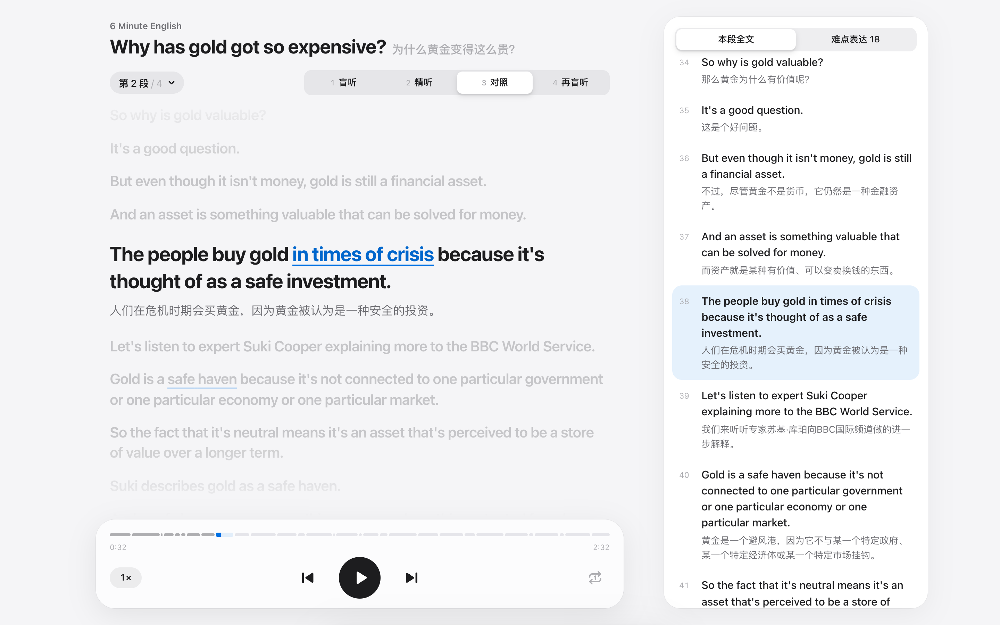
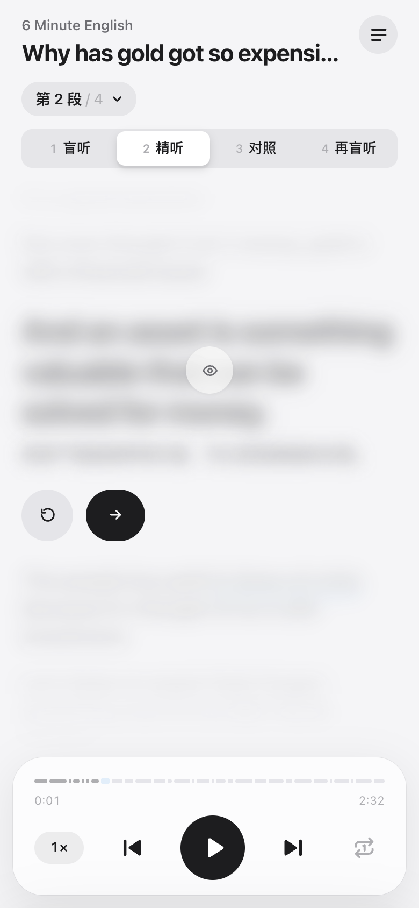
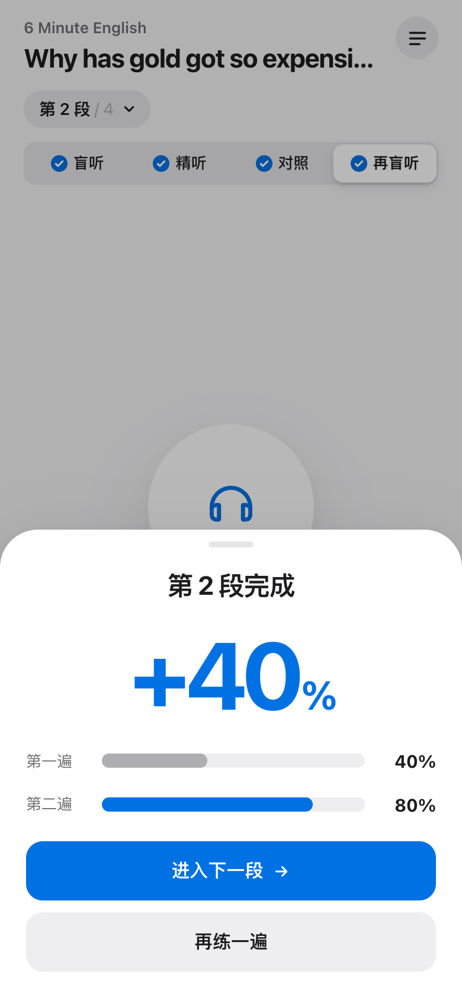
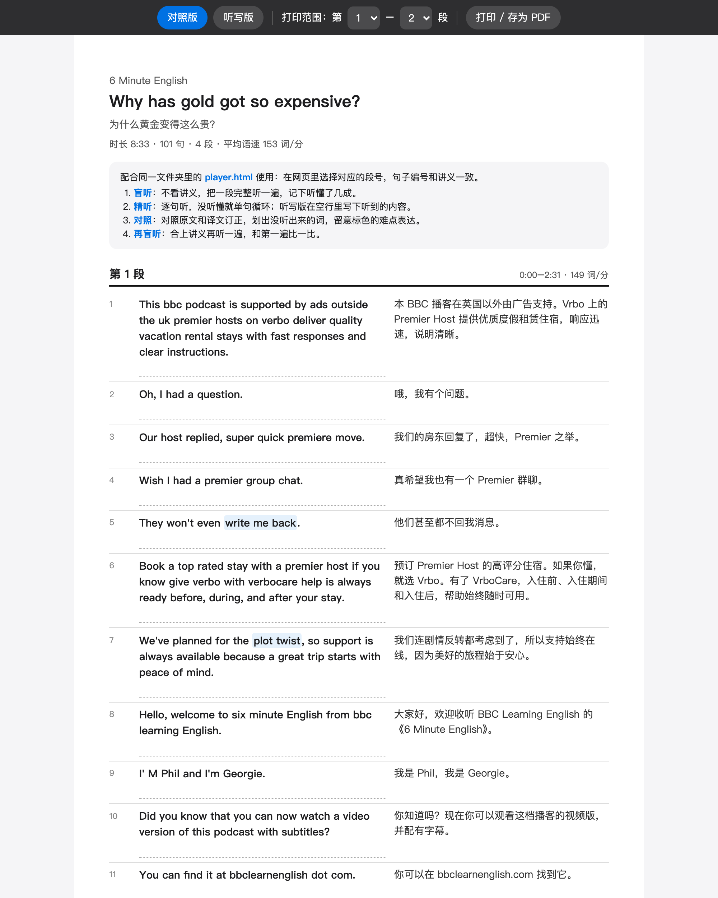
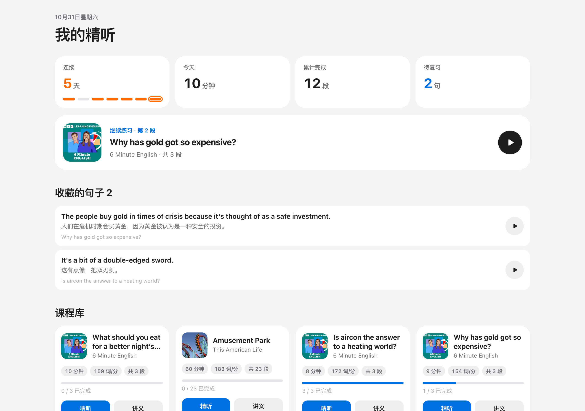
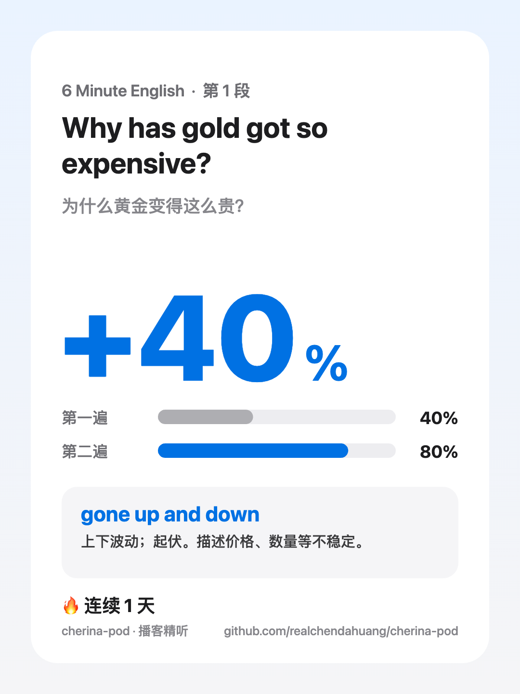

<div align="center">


# cherina-pod

**一句话，把任意一期播客变成一节精听课。**

逐句精听网页 · 可打印双语讲义 · 难点表达笔记 · 自动跳过广告 · 手机直接练 —— 全部在你自己的电脑上生成

[](LICENSE)
[](https://www.python.org/)
[](SKILL.md)
[](https://github.com/realchendahuang/cherina-pod/actions/workflows/ci.yml)
[](https://github.com/realchendahuang/cherina-pod/stargazers)
[](https://github.com/realchendahuang/cherina-pod/commits/main)

中文 · [English](README.en.md)



</div>

## 为什么做这个

用播客练英语听力的人都卡在同几个地方：找不到带文本的材料，听不懂的那句拖进度条找半天，不知道该怎么精听，听完也不知道有没有进步。

cherina-pod 把这些都自动化了。给它一期播客，它会：

1. 下载音频，转写出**带词级时间戳**的原文
2. 逐句翻译（信达雅，保留口语感）
3. **自动识别并跳过广告和赞助口播**
4. 按你的水平挑出这一期最值得学的 20 个难点表达
5. 生成**离线精听网页**、**可打印讲义**和一个能直接发到手机上的**单文件课**
6. 把所有课汇总进**课程库**，记录连续打卡、收藏的句子和复习计划

全程在本地运行，不需要注册，不上传你的数据。可以直接当命令行工具用，也可以作为 **Agent Skill** 交给 Claude Code、WorkBuddy、Codex 等 agent，一句话调用。

## 效果

<table>
<tr>
<td align="center" width="25%"><br><b>精听</b><br><sub>每句播完自动停，点一下才显示原文</sub></td>
<td align="center" width="25%"><br><b>对照</b><br><sub>逐词高亮，难点表达点开看解释</sub></td>
<td align="center" width="25%"><br><b>看得见的进步</b><br><sub>两遍盲听自评，+40%</sub></td>
<td align="center" width="25%"><br><b>打印讲义</b><br><sub>对照版 / 听写版，存 PDF</sub></td>
</tr>
</table>

<table>
<tr>
<td align="center" width="62%"><br><b>课程库</b><br><sub>连续天数、今天练了多久、继续上次那一段、收藏的句子</sub></td>
<td align="center" width="38%"><br><b>一键生成分享卡片</b><br><sub>3:4 竖图，直接发小红书 / 朋友圈</sub></td>
</tr>
</table>

<sub>截图里的打卡数据为演示用。</sub>

### 精听网页 `player.html`

- **四步精听法，自动往下走**：盲听 → 逐句精听 → 对照 → 再盲听。只需要按播放键和“下一句”，每一步结束会自动进入下一步
- **逐词高亮**：播到哪个词，哪个词亮起来（词级时间戳驱动）
- **单句循环、0.75–1.25 倍速、点进度条任意一格跳到那一句**
- **难点表达**：原文里带下划线，点开看释义和原句
- **两遍自评对比**：第一遍和第二遍盲听各打一次分，练完看到进步幅度
- **自动跳过广告**：片头片尾的广告、赞助口播、其他节目的推广都会被识别出来，播放时直接跳过
- **收藏句子**：点书签收藏，回到课程库用“先听后看”的卡片复习
- **分享卡片**：练完一段，一键生成带进步幅度和连续天数的竖版图片
- 双击即开、完全离线；手机、电脑、深色模式都适配；进度保存在浏览器里

### 课程库 `episodes/index.html`

- 连续打卡天数、近 7 天打卡条、今天练习分钟数、累计完成段数
- “继续练习”一键回到上次那一段
- 收藏的句子与**间隔复习**：先播放原句，回想意思，再翻面；按“忘了 / 模糊 / 记住了”安排下次复习
- 所有课的进度一览

### 打印讲义 `handout.html`

- 原文和译文左右对照，每句下面留订正空行
- 一键切换**听写版**（只留编号和空行，答案附在后面）
- 可选打印范围（一小时的节目不用全打印），浏览器打印即可存成 PDF

### 难点笔记 `notes.md`

- 每条包含表达、类型、释义、原句、时间点，可以直接放进 Obsidian

## 两种用法

- **交给 AI agent（推荐，最省事）**：一行 `npx skills add realchendahuang/cherina-pod` 装进 Claude Code / Codex / Cursor，之后用大白话说「把这期播客做成精听课」就行。见[作为 Agent Skill 使用](#作为-agent-skill-使用推荐)。
- **自己用命令行**：`git clone` 下来，跑 `python3 scripts/lesson.py`。见下面的[快速开始](#快速开始)。

两种方式底层是同一套脚本，产物完全一样。

## 快速开始

> 下面是命令行用法。想让 AI agent 替你跑，直接看[作为 Agent Skill 使用](#作为-agent-skill-使用推荐)。

### 1. 准备环境

需要 **Python 3.10+** 和 **ffmpeg**。

```bash
# macOS
brew install ffmpeg
# Ubuntu / Debian
sudo apt install ffmpeg
```

### 2. 下载项目，填一个密钥

```bash
git clone https://github.com/realchendahuang/cherina-pod.git
cd cherina-pod
python3 scripts/lesson.py --setup
```

`--setup` 会请你粘贴一个 `DASHSCOPE_API_KEY`，保存后自动自检。这是**唯一必需**的密钥，转写、翻译、难点表达都用它：

1. 打开 [阿里云百炼控制台](https://bailian.console.aliyun.com/)，登录（国际站同样可用）
2. 左侧进入「API-KEY」，创建一个 Key，复制
3. 回到终端粘贴（输入时不显示），Key 会保存在 `~/.config/cherina-pod/.env`，只有你自己能读

也可以手动配置：`cp .env.example .env`，在里面填 `DASHSCOPE_API_KEY=sk-xxxx`。

想换成别的翻译模型（比如 DeepSeek 官方、OpenAI），在 `.env` 里另填 `LLM_BASE_URL`、`LLM_API_KEY`、`LLM_MODEL` 即可，见 [.env.example](.env.example)。

### 3. 检查一下

```bash
python3 scripts/lesson.py --doctor
```

最后一行全是 `"ok": true` 就可以开始了。哪一项是 `false`，后面的 `fix` 会告诉你怎么修。

### 3.5 不知道听什么？

```bash
python3 scripts/lesson.py --recommend --level 四级
```

会按你的水平推荐 6 档播客，并给出可以直接用的来源地址。也可以直接看下面的[播客推荐](#去哪里找播客)。

### 4. 生成第一节课

```bash
python3 scripts/lesson.py "6 Minute English" --level 四级
```

一期 6 分钟的节目大约 1–2 分钟完成，一小时的节目大约 5–15 分钟。完成后最后一行会给出文件路径：

```
RESULT {"ok": true, "title": "Is aircon the answer to a heating world?", "player": ".../player.html", "handout": ".../handout.html", ...}
```

### 5. 开始练

```bash
open episodes/index.html      # 课程库；Windows 用 start，Linux 用 xdg-open
```

在课程库里点「继续练习」，或者直接打开某一期的 `player.html`。

### 6. 在手机上练

三种方式，任选一种：

| 方式 | 怎么做 | 适合 |
|---|---|---|
| **单文件** | 20 分钟以内的节目会自动生成 `share/<期名>.html`（音频已内嵌，几 MB），用微信、AirDrop 发到手机，用浏览器打开 | 短节目、发给朋友 |
| **局域网** | 电脑上运行 `python3 scripts/lesson.py --serve`，手机连同一个 Wi-Fi，打开它打印出的地址 | 在家用，所有课和进度都在 |
| **长节目分段** | `python3 scripts/lesson.py "<来源>" --phone --parts 1-3`，只打包前 3 段 | 一小时的长节目 |

> iPhone 上请用 Safari 打开单文件（在微信里点开后选「在 Safari 中打开」，或在「文件」App 里长按 → 共享 → Safari）。

## 使用教程

### 指定来源

`lesson.py` 的第一个参数可以是下面任意一种：

| 你手上有的 | 例子 |
|---|---|
| 播客名 | `python3 scripts/lesson.py "All Ears English"` |
| Apple Podcasts 链接（节目或某一集） | `python3 scripts/lesson.py "https://podcasts.apple.com/us/podcast/.../id262026947"` |
| RSS 地址 | `python3 scripts/lesson.py "https://podcasts.files.bbci.co.uk/p02pc9tn.rss"` |
| 本地音频文件 | `python3 scripts/lesson.py ~/Downloads/lecture.m4a` |

### 指定哪一集

```bash
python3 scripts/lesson.py "6 Minute English" --list              # 先看最近 15 集
python3 scripts/lesson.py "6 Minute English"                     # 默认最新一集
python3 scripts/lesson.py "6 Minute English" --episode 3         # 第 3 新的一集
python3 scripts/lesson.py "6 Minute English" --episode "gold"    # 标题里含 gold 的那一集
```

### 其他选项

| 选项 | 作用 |
|---|---|
| `--level "雅思 6"` | 按你的水平挑难点表达，例如 `四级`、`六级`、`雅思 6`、`高中` |
| `--lang zh-en` | 中文播客配英文译文（给学中文的外国朋友用）；默认 `en-zh` |
| `--no-notes` | 不调用模型：不生成难点表达，也不识别广告 |
| `--phone` / `--parts 1-3` | 强制生成手机单文件 / 只打包这几段 |

### 精听网页怎么用

| 操作 | 手机 | 电脑 |
|---|---|---|
| 播放 / 暂停 | 点中间的大圆或底部 ▶ | `空格` |
| 上一句 / 下一句 | ⏮ ⏭ | `←` `→` |
| 单句循环 | 右下角 🔁 | `R` |
| 精听时偷看原文 | 点模糊的文字 | `T` |
| 跳到某一句 | 点进度条上对应的那一格 | 同左 |
| 切换段落 | 点左上角「第 N 段」 | 同左 |
| 看全文、难点表达 | 右上角 ☰ | 右侧常驻 |
| 收藏这一句 | 精听或对照时，句子下方的书签 | 同左 |
| 分享成绩 | 练完一段后的「分享成绩」 | 同左（下载图片） |
| 回到课程库 | 右上角 ⊞ | 同左 |
| 切换步骤 | 顶部四个按钮 | `1`–`4` |

要在手机上练：把整个期目录（`player.html` 和 `audio/` 文件夹一起）传到手机，用浏览器打开 `player.html`。

### 只重新生成网页和讲义

已经转写和翻译过的期，可以只调整分段和难点数量，不会再花转写费用：

```bash
python3 scripts/build_lesson.py episodes/<目录> --seg-seconds 120 --notes 30
```

### 批量生成

在 `scripts/batch_jobs.txt` 里每行写一个任务（`<RSS 地址> <集编号>`），然后：

```bash
bash scripts/batch_add.sh
```

### 产物在哪里

默认在 `episodes/<这一期>/`：

```
episodes/
├── index.html                       课程库（所有课、打卡、收藏、复习）
└── why-has-gold-got-so-expensive/
    ├── player.html                  精听网页（双击打开）
    ├── share/*.html                 手机单文件（音频内嵌）
    ├── handout.html                 打印讲义
    ├── notes.md                     难点笔记
    ├── ads.json                     识别出的广告句
    ├── audio/episode.mp4            音频（AAC 64k 单声道）
    ├── bilingual.json               原文 + 译文 + 时间戳
    └── transcript.json              词级时间戳（重新转写要花钱，请自行备份）
```

设置环境变量 `CHERINA_POD_OUT=/你想放的目录` 可以改到别处。

## 作为 Agent Skill 使用（推荐）

仓库根目录本身就是一个完整的 skill（[SKILL.md](SKILL.md) + `scripts/`），交给 Claude Code、Codex、Cursor、OpenCode 等 agent，一句话就能调用。

### 一行命令装进你的 agent

用开源的 [`skills` CLI](https://github.com/vercel-labs/skills)（支持 50+ agent），不用手动找目录：

```bash
# 装到当前项目
npx skills add realchendahuang/cherina-pod

# 装到用户全局目录（-g），并指定 agent（可多选）
npx skills add realchendahuang/cherina-pod -g --agent claude-code
```

或者手动克隆到 agent 的 skills 目录：

```bash
# Claude Code
git clone https://github.com/realchendahuang/cherina-pod.git ~/.claude/skills/cherina-pod
# Codex、Cursor、OpenCode 等：克隆到各自的 skills 目录
```

> skill 依赖本机的 **Python 3.10+** 和 **ffmpeg**，装好 skill 后第一次使用时对 agent 说「帮我自检环境」，它会替你跑 `--doctor` 并提示缺什么。

### 填一个密钥，然后说人话

把密钥放在 `~/.config/cherina-pod/.env`（或 skill 目录下的 `.env`，内容是一行 `DASHSCOPE_API_KEY=sk-xxxx`），然后直接对 agent 说：

> 把 6 Minute English 讲金价的那一期做成精听课，我雅思 6 分。

agent 会自己找到那一期、生成、把文件路径告诉你。`lesson.py` 最后一行固定输出 `RESULT {json}`，失败时带有出错环节和修复建议，所以即使是小模型也能照着 SKILL.md 跑通（我们用 DeepSeek V4.1 Flash 实测过）。

## 去哪里找播客

cherina-pod 支持**有公开 RSS 的播客**（绝大多数播客都有）。Spotify 独家节目、YouTube 视频暂不支持。

### 找播客的网站

| 网站 | 用途 |
|---|---|
| [Apple Podcasts](https://podcasts.apple.com/) | 最全的目录。找到节目后直接复制网页链接给 cherina-pod |
| [Podcast Index](https://podcastindex.org/) | 开放的播客目录，每个节目都能看到 RSS 地址 |
| [Listen Notes](https://www.listennotes.com/) | 播客搜索引擎，可以按话题搜单集 |
| [Castbox](https://castbox.fm/) | 播客客户端，节目页里能找到 RSS |
| [Podcast Addict 目录](https://podcastaddict.com/) | 安卓播客客户端，也有网页目录 |

### 适合练听力的英文播客（由易到难）

| 难度 | 播客 | 特点 |
|---|---|---|
| 入门 | [BBC Learning English: 6 Minute English](https://www.bbc.co.uk/learningenglish/english/features/6-minute-english) | 每期 6 分钟，英音，主持人会解释生词 |
| 入门 | [VOA Learning English](https://learningenglish.voanews.com/)（American Stories） | 慢速朗读，美音，用词有限 |
| 入门 | Easy English（Isi & Mitch） | 两位主持人的日常对话，语速慢 |
| 入门 | English Learning for Curious Minds | 慢速讲有趣的故事和知识 |
| 中级 | [All Ears English](https://www.allearsenglish.com/) | 美式口语、地道表达 |
| 中级 | Luke's English Podcast | 英国老师的长篇闲聊，幽默 |
| 中级 | [TED Talks Daily](https://www.ted.com/podcasts/ted-talks-daily) | 演讲，话题广，发音清晰 |
| 中级 | The Psychology of your 20s | 年轻人话题，口条清楚 |
| 进阶 | [Hidden Brain](https://hiddenbrain.org/) | 心理学叙事，NPR 制作 |
| 进阶 | [The Daily](https://www.nytimes.com/column/the-daily)（纽约时报） | 新闻深度，正常语速 |
| 进阶 | Planet Money / Freakonomics Radio | 经济学故事和访谈 |
| 进阶 | Radiolab | 科学与哲学故事，音效丰富 |
| 进阶 | [This American Life](https://www.thisamericanlife.org/) | 真实故事，口语多、语速快 |

这些节目都收录在 `scripts/catalog.json` 里，`--recommend` 会从中挑选。建议选**能听懂 70%–80%** 的节目：太简单练不到东西，太难会放弃。网页里每段都标了语速（词/分），可以参考。

### 适合学中文的播客（`--lang zh-en`）

| 播客 | 特点 |
|---|---|
| Coffee Break Chinese | 面向英语母语者的分级中文课 |
| Mandarin Blueprint | 学习方法与中文对话 |
| Slow Chinese Podcast（慢速汉语） | 语速慢，话题是中国日常和文化 |

## 工作原理

```
lesson.py
  └─ 解析来源（播客名 / Apple 链接 / RSS / 本地文件）
     ├─ fetch_podcast.py   下载音频，压成 AAC 64k 单声道
     ├─ transcribe.py      阿里云 Paraformer 转写，保留词级时间戳
     ├─ translate.py       LLM 逐句翻译，并发、可断点续跑
     ├─ align.py           按时间戳对齐 → bilingual.json
     └─ build_lesson.py    分段、算语速、挑难点 → player.html / handout.html / notes.md
```

`transcript.json` 是转写和后续步骤之间唯一的接口。任何 ASR（`mlx-whisper`、`faster-whisper`、`whisper.cpp`）只要输出这个结构就能接进来：

```json
{
  "duration": 21.0,
  "sentences": [ { "text": "一句原文", "start": 0.0, "end": 1.6 } ],
  "words":     [ { "word": "词 ", "start": 0.0, "end": 0.28 } ]
}
```

## 常见问题

**广告识别错了怎么办？**
宁可漏标，不会误删正文：单句、不在片头片尾、也没有广告用语的不会被删。想保留全部原文，用 `python3 scripts/build_lesson.py episodes/<目录> --keep-ads` 重新生成。

**学习记录存在哪？换浏览器还在吗？**
存在浏览器本地（localStorage），不上传。换浏览器或清除浏览器数据会丢失。用 `--serve` 在手机上练时，记录存在手机浏览器里。

**要花多少钱？**
费用全部来自你自己的阿里云百炼账户：转写按语音时长计费（只计有人声的部分），翻译和难点表达按 token 计费，具体单价以[百炼官方计费说明](https://help.aliyun.com/zh/model-studio/billing-for-model-studio)为准。新账户通常有免费额度。已经转写过的期重新生成网页和讲义不会再产生转写费用。

**转写有错怎么办？**
ASR 偶尔会听错人名和专有名词（比如把 Ira Glass 听成 “I remember glass”）。这不影响练听力，反而可以当作“机器也听错了”的有趣素材。

**可以把生成的讲义发到网上或卖吗？**
不建议。生成的转写、译文、讲义来自第三方播客，只适合个人学习。公开分享或出售前，请先取得内容方授权。本仓库默认不提交任何生成内容（见 `.gitignore`）。

**Windows 能用吗？**
可以，命令里的 `python3` 换成 `python`，`open` 换成 `start`。

## 参与贡献

欢迎提 Issue 和 PR，见 [CONTRIBUTING.md](CONTRIBUTING.md)。特别欢迎：

- 本地 ASR 适配（mlx-whisper / faster-whisper），让转写也免费
- 听写模式（打字输入，和原文逐词比对）
- Anki 导出（带原句音频）
- 更多语言对的使用反馈
- 你在用的、适合精听的播客推荐

## 许可

[AGPL-3.0](LICENSE)。修改后对外提供服务，需要同样开源。

## Star History

[](https://star-history.com/#realchendahuang/cherina-pod&Date)
